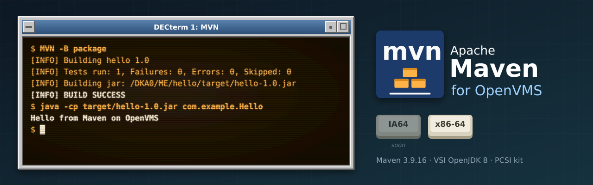

<p align="center">
  
</p>

# Apache Maven for OpenVMS


[](LICENSE)

[Apache Maven](https://maven.apache.org) (**3.9.16**) for OpenVMS on **IA64** and
**x86-64**, running on VSI OpenJDK 8. It belongs to the same family as
[GNU grep](https://github.com/issinoho/vms-grep), [curl](https://github.com/issinoho/vms-curl),
[Vim](https://github.com/issinoho/vms-vim) and the other
[vms-* ports](https://openvms.issinoho.com).

Maven is Java, so most of it runs on OpenVMS as it is. This repository holds **only our
changes** over the signed upstream binary distribution:

- **`MVN.EXE`**, a launcher that does what `bin/mvn` does (Maven home, Java, the `.mvn`
  project directory, `jvm.config`, `MAVEN_OPTS`). It is an image rather than a DCL
  procedure, so goals and options such as `-DskipTests` keep their case and there is no
  limit of eight parameters.
- **Patched classes** for the places where Maven assumes Unix or Windows file behaviour,
  compiled on the node and put back into the jar they came from. Each patch is written so
  it can go upstream.

**Status:** [v3.9.16-vms1](https://github.com/issinoho/vms-maven/releases/tag/v3.9.16-vms1)
for x86-64. The IA64 kit will follow (docs/PLAN.md).

## Using it

From the kit (`tools/kit.sh`):

```dcl
$ PRODUCT INSTALL MAVEN /SOURCE=<directory with the kit>
$ @MAVEN$ROOT:[000000]MAVEN$SETUP.COM    ! defines MVN; sets up Java if needed
```

`MAVEN$STARTUP.COM` (in `SYS$STARTUP`) defines `MAVEN$ROOT` at boot; the kit's
`README.VMS` has the rest. From a build tree:

```dcl
$ @SYS$STARTUP:OPENJDK$SETUP.COM          ! Java 8
$ SET PROCESS/PARSE_STYLE=EXTENDED       ! keep the case of arguments
$ MVN :== $DISK$USER:[USERNAME.VMS_MAVEN.APACHE-MAVEN-3_9_16.BIN]MVN.EXE
$ PIPE MVN -B package > build.log
```

- Under the TRADITIONAL parse style (the default, and what batch jobs get), arguments not in
  quotes reach Maven in lower case. The launcher prints a note when Maven then fails.
- Plugins that start programs through `/bin/sh` (surefire's forked test JVM) get
  `MVNSH.EXE`, which runs the `cd DIR && PROGRAM ARGS` form they use; the launcher maps
  `/bin/sh` to it through VSI Java's `JAVA$EXEC_MAPPING_nn`.
- **Quotas:** Java on OpenVMS wants FILLM 4096 and PGFLQUOTA 2097152 (HP's Java user
  guide). A forked test JVM shares them with Maven's, so with a default account's quotas
  larger builds fail ("unable to create new native thread"); the launcher says so when a
  build fails. Its default JVM sizes are small for the same reason; `MAVEN_OPTS` and
  `.mvn/jvm.config` override them.
- To keep a build's output in a file, use `PIPE MVN ... > file`: with
  `DEFINE/USER SYS$OUTPUT`, each process in the chain writes its own version. In a PIPE or
  a batch log the launcher passes Maven's output on a line at a time; Java on its own wrote
  an empty record after every line there (NOTES N25).
- **Plugins that run programs:** the launcher also maps the bare names `java`, `javac`,
  `javadoc` and `jar` to the JDK's images, since Ant (antrun) and others start `java`
  when they find no `bin/java` (it is `JAVA.EXE`). The `openvms` profile in
  `conf/settings.xml` points the javadoc plugin at `JAVADOC.EXE` and makes tar archives
  POSIX, so an OpenVMS UIC fits as the owner. Known problems (NOTES N20):
  `exec:exec` fails (a bug in commons-exec's OpenVMS launcher; use `exec:java`), and
  antrun's `<java fork>` splits an argument that contains a space.
- **File versions:** Java writes a new version of a file each time it rewrites one, so
  a local repository collects versions of `maven-metadata-local.xml`, checksums and
  reinstalled artifacts. The launcher creates a missing local repository
  (`SYS$LOGIN:[.m2.repository]`, or `-Dmaven.repo.local`) with a version limit of 1, so
  a new version replaces the old. For a repository that already exists, or one named
  only in `settings.xml`:

  ```dcl
  $ SET DIRECTORY/VERSION_LIMIT=1 SYS$LOGIN:[.m2.repository...]
  $ SET FILE/VERSION_LIMIT=1 SYS$LOGIN:[.m2.repository...]*.*;
  $ PURGE SYS$LOGIN:[.m2.repository...]
  ```
- The resolver's cross-process file locks are on (two builds can share a repository),
  with their lock files kept in `.locks`: VSI Java's handling of the resolver's
  delete-on-close lock files deleted the jars Maven had open, plugin jars and, with
  SYSPRV, the JDK's `tools.jar` (NOTES N21).
- **Settings and toolchains:** `conf/settings.xml` and `conf/toolchains.xml` in the Maven
  tree, and `settings.xml`, `toolchains.xml` and `repository` in `SYS$LOGIN:[.m2]` (Java's
  user.home), as on other systems. Give file options such as `-s` and `-f` Unix paths
  (`-s /DISK$USER/USERNAME/alt.xml`). A JDK toolchain's `jdkHome` is the JDK's directory
  as a Unix path, e.g. `/SYS$COMMON/openjdk$80` (NOTES N22).
- **On a terminal:** CTRL/C and CTRL/Y both stop Maven (Java runs its shutdown hooks).
  CTRL/Y goes to the launcher, which passes it on to Java, so there is no CONTINUE.
  The launcher exits with an error status (`%X1035A412`, exit code 130), but DCL acts
  on the key as well once MVN ends, so `$STATUS` at the prompt after either key is not
  reliable, and a procedure that ran MVN is interrupted. Colour is off unless you ask for
  it (`-Dstyle.color=always`). Starting Maven takes a while: about 45 s on x86-64 before
  the first line of a build, all of it Java loading classes (NOTES N24).
- `MAVEN_OPTS`, `MAVEN_ARGS`, `JAVA_HOME`, `MAVEN_HOME` and `MAVEN_BASEDIR` may be DCL
  symbols or logical names. `MAVEN_VMS_TRACE` prints the Java command line.

## Patches

| Patch | What | Why |
|---|---|---|
| 0001 | resolver: close a tracking file before deleting it | OpenVMS cannot delete an open file; every download failed (NOTES N2) |
| 0002 | conf/settings.xml: small argLine for forked tests on OpenVMS | the forked JVM shares Maven's pooled quotas (N12) |
| 0003 | conf/settings.xml: javadoc tool and POSIX tar on OpenVMS | the plugin finds no `bin/javadoc`; a UIC is too big for the old tar header (N20) |
| 0004 | maven-core: a JDK toolchain finds `<tool>.exe` on OpenVMS | it found no `bin/javac`, so the compiler used the bare `javac`, not the toolchain's (N22) |

## Building

```sh
tools/prepare.sh                 # fetch + verify, unpack, patch -> staging/
tools/build.sh <ia64|x86>        # MVN.EXE and the patched jars, on the node
tools/test.sh <node> [suite]     # batch job, uses Maven Central: smoke (default),
                                 # projects, plugins, config
tools/ttytest.sh <node>          # MVN on a terminal: output, colour, CTRL/C, CTRL/Y
tools/kit.sh <node>              # build, then the PCSI kit -> out/kits/
tools/installcheck.sh <node>     # install the kit, smoke-test it, remove it
```

ttytest.sh needs pexpect and pyte on the build host (`python3 -m venv cache/venv;
cache/venv/bin/pip install pexpect pyte`, or set `TTYTEST_PYTHON`).

`tools/nodes.conf` (from `nodes.conf.example`) names the nodes. Builds need VSI C and VSI
OpenJDK 8 on the node; nothing Java is compiled on the build host.

## Artwork

`docs/images/banner.svg` was made for this project in the style of classic DECwindows and
VT terminals, like those of its sibling ports. The "mvn" mark in it is our own drawing, not
Apache Maven's logo.

## Licence

Maven and its jars are under the Apache License 2.0 (see `LICENSE` and `lib/*.license` in
the distribution); our files are under the same licence.
